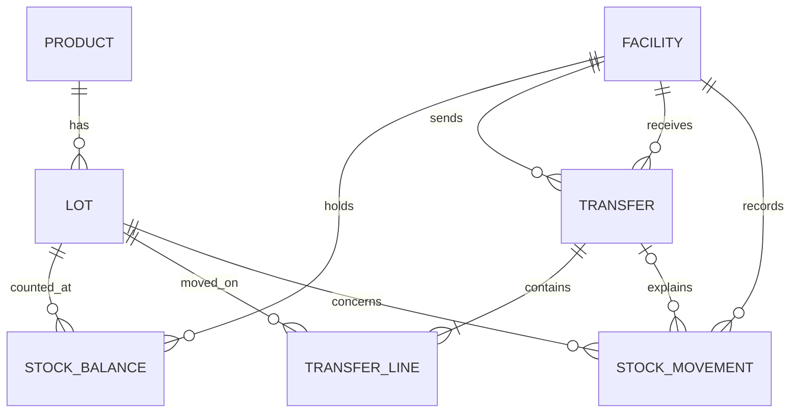

# Portfolio 1: database design and modelling

The model stores operational vaccine inventory in PostgreSQL. Quantities are **sealed vials**. A product records doses per vial for reporting, but stock transactions never mix doses with vials. Every lot belongs to one product. A stock balance represents one lot at one facility. Transfers reserve stock before dispatch and record receipt separately. `stock_movement` is an append-only audit ledger; each operation writes its balance change and movement in one transaction.

## Model

The transfer header holds the source, destination, state and times. Transfer lines hold the lots and quantities. This avoids repeating header data when a transfer has several lines. Product attributes stay in `product`, lot attributes stay in `lot`, and facility attributes stay in `facility`. The balance key `(facility_id, lot_id)` determines both quantity columns. These dependencies keep the operational tables in third normal form. The balance is a deliberate materialisation of the movement ledger for fast allocation; reconciliation checks compare it with movement sums.

## Constraints and boundaries

- Primary and foreign keys reject missing references. Unique codes and request keys reject duplicate business identities.
- Checks enforce positive line quantities, nonnegative balances, `reserved <= on_hand`, distinct transfer endpoints, ordered timestamps and valid states.
- A lot's `quality_status` is explicit. A quarantined or disposed lot needs a quality note. Time-dependent eligibility, including expiry, is checked inside allocation functions because a static check constraint cannot depend on today's date.
- The database schema is the operational core for portfolios 1-3. Equipment, sensor readings and review workflow are planned for portfolio 4 and are not claimed as implemented here.

## Rebuild

Run `01_schema.sql` against an empty or disposable PostgreSQL 18 database. It drops and recreates only the `vaxtrace` schema. Follow with the seed and verification scripts documented in the root README when those increments are complete.
