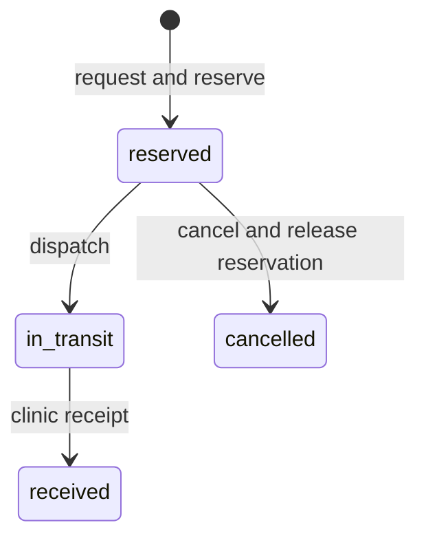

# Portfolio 3: transactions and concurrency

VaxTrace NG reserves sealed vials at a depot, dispatches them, and records receipt at a clinic. PostgreSQL is the stock authority. `01_transfer_functions.sql` implements four operations: request/reserve, dispatch, receive, and cancel. Each function changes the balance and appends its audit movement in one database statement. The caller can commit or roll back that statement. Dispatch and receipt are separate commits because they represent separate physical events.

`request_key` is unique, so retrying an already committed request does not create a second transfer. The reservation uses a conditional `UPDATE` on one balance row: it succeeds only if `on_hand_vials - reserved_vials` is sufficient. At PostgreSQL's default `READ COMMITTED` isolation, concurrent updates to that row serialize and recheck the predicate after a waiting transaction acquires the lock. The lot row is held with a share lock while its quality and expiry are checked. Dispatch checks those conditions again because they can change after reservation. No transfer is dispatched from quarantined or expired stock. A receipt can record stock even if the lot has since become quarantined, but allocation still refuses it.

## Reproduce

Start with a clean database from the Portfolio 1 schema and seed. Load `01_transfer_functions.sql`, then run `02_transaction_demo.sql`, `03_adversarial_tests.sql`, and `04_concurrency_test.py` in that order. The root `scripts/rebuild_and_verify.ps1` automates the full sequence on Windows. The script uses an isolated local PostgreSQL database and does not require a password when configured with the local test cluster described in the root README.

The demo commits a 10-vial transfer of `VX-001 / LOT-000001` from depot to clinic, then rolls back a separate 30-vial reservation. The adversarial script checks insufficient stock, nonpositive quantity, duplicate request key, expiry, quarantine, same endpoints, duplicate dispatch and receipt, and quarantine after reservation. The concurrency script starts two independent sessions, each attempting to reserve 70 of 100 available vials. The winning transaction holds its lock briefly to force overlap. Exactly one can commit; the other receives an insufficient-stock error. The winner is then cancelled so the test leaves the lot's availability unchanged.

## Evidence

- `evidence/transaction-demo.txt`: before and after balances, transfer states, movements and rollback.
- `evidence/adversarial-tests.txt`: rejection checks and ledger reconciliation.
- `evidence/concurrency-test.txt`: two-session outcome and cancellation.
- `evidence/clean-rebuild.txt`: repeat rebuild of the disposable test database and all functional tests.
- `evidence/fresh-database-rebuild.txt`: the same suite on a newly created independent database.
- `evidence/final-integrity.txt`: post-concurrency balance, ledger and state checks.

These are local demonstrations, not a production service. A production implementation would need controlled application roles, monitoring, operational backups, and a defined workflow for physical receipt disputes and temperature review. The demonstration does not claim those features.

References: PostgreSQL, [Transaction Isolation](https://www.postgresql.org/docs/18/transaction-iso.html); PostgreSQL, [Explicit Locking](https://www.postgresql.org/docs/18/explicit-locking.html).
